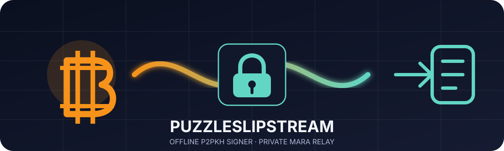

<div align="center">
  

# PuzzleSlipstream

**Offline signing for authorized Bitcoin Puzzle legacy keys, followed by private MARA Slipstream submission.**


</div>

> [!CAUTION]
> **Alpha and unaudited. Do not use this software with valuable mainnet funds until the exact source revision has received an independent security review.** Test on Regtest and Testnet4 first.

## What this project does

PuzzleSlipstream is a two-application, offline-first Bitcoin transaction sweeper:

1. **PuzzleSlipstream Signer** runs on an offline computer. It verifies full previous transactions, derives the matching compressed or uncompressed legacy P2PKH public key, creates a one-output/no-change sweep, signs every input with `SIGHASH_ALL`, verifies the completed transaction, and encrypts a `.swe` transfer envelope.
2. **PuzzleSlipstream Relay** runs on an online computer. It decrypts and independently validates the signed transaction, can run `testmempoolaccept` against your own loopback Bitcoin Core node, and submits only to the selected private relay. It has **no public broadcast fallback**.

The repository name intentionally mentions **Bitcoin Puzzle** and **MARA Slipstream**, but this project does **not** solve puzzles, scan key ranges, recover private keys, or perform brute force. You must already possess the private key and be authorized to spend every selected UTXO.

## The security fact that matters

A legacy P2PKH spend necessarily places the public key in the input `scriptSig`. A private relay does not remove that public key. It aims to keep the signed transaction out of the public mempool before a cooperating miner sees and potentially confirms it.

MARA, its infrastructure, and any party that receives the transaction can still see the public key and raw transaction. Private submission reduces one exposure path; it is not a mathematical guarantee of inclusion, secrecy, or safety.

## Repository layout

```text
apps/
  puzzle-slipstream-signer/   Offline native GUI; contains signing code path
  puzzle-slipstream-relay/    Online native GUI; contains network code path
crates/
  puzzle-slipstream-core/     Transaction, envelope, validation, relay and RPC library
docs/                         Threat model, guides and API notes
examples/                     Safe example formats; no real private keys
schemas/                      JSON Schemas for UTXO bundles and encrypted envelopes
scripts/                      Build, package and local-node helper scripts
tools/                        Loopback-only mock relay for testing
```

## Security properties

- The **Signer never imports `reqwest`, Tokio networking, DNS, HTTP, or relay code**.
- Private keys are accepted only by the Signer and cleared from the GUI state after each signing attempt.
- A sweep contains exactly one destination output and no change output.
- Every input uses `SIGHASH_ALL`, final sequence, empty witness, and a legacy P2PKH `scriptSig`.
- Full previous transactions are parsed offline; their computed transaction IDs, output indexes, values, and scripts are verified.
- The Relay re-parses the transaction and independently verifies every ECDSA signature before submission.
- Relay destinations are compiled presets. Redirects and environment proxy settings are disabled.
- The default build excludes mainnet. Mainnet requires the `mainnet` Cargo feature and an explicit typed confirmation in both GUIs.
- There is no automatic or manual public-mempool endpoint in the application.

Read [THREAT_MODEL.md](THREAT_MODEL.md) before using the software.

## Build prerequisites

- Current stable Rust toolchain
- Windows 11, macOS, or a Linux desktop supported by Iced
- Optional: Bitcoin Core for local `testmempoolaccept` and confirmation checks

### Default test-network build

```bash
cargo fmt --all -- --check
cargo test --workspace
cargo build --release --workspace
```

Run the applications:

```bash
cargo run -p puzzle-slipstream-signer
cargo run -p puzzle-slipstream-relay
```

### Mainnet-capable build

Mainnet is deliberately compile-gated:

```bash
cargo build --release --workspace --features mainnet
```

A mainnet build is not an endorsement that the software is safe. It remains blocked by the runtime phrase `SWEEP MAINNET` and, in the Relay, `SUBMIT TO MARA`.

## Safe workflow

1. Build the Signer from reviewed source on a clean computer.
2. Disconnect networking and verify it is offline.
3. Obtain each complete previous transaction from your own Bitcoin Core node and create a UTXO bundle.
4. In the Signer, review the computed source address, destination, amount, fee, and exact transaction ID.
5. Export the encrypted `.swe` file. Move only that encrypted file to the online computer.
6. In the Relay, decrypt and re-check the transaction. Prefer running the local Bitcoin Core policy check.
7. Submit to MARA Slipstream. “Accepted by relay” is **not** “confirmed.”
8. Track the destination output using your own node. Never rebroadcast through a public service as a fallback.

Detailed instructions: [docs/USER_GUIDE.md](docs/USER_GUIDE.md).

## UTXO bundle input

The Signer intentionally does not contact an explorer. It imports a JSON bundle containing each complete previous transaction and the output index being spent:

```json
{
  "format": "puzzle-slipstream-utxos",
  "version": 1,
  "network": "regtest",
  "inputs": [
    {
      "previous_transaction_hex": "02000000...",
      "vout": 0,
      "label": "authorized test output"
    }
  ]
}
```

See [schemas/utxo-bundle.schema.json](schemas/utxo-bundle.schema.json) and [docs/CREATING_UTXO_BUNDLE.md](docs/CREATING_UTXO_BUNDLE.md).

## MARA adapter

The third-party API is isolated in `crates/puzzle-slipstream-core/src/relay.rs`. Before any mainnet use, compare the production preset and request schema with MARA's current official documentation. The client:

- sends `tx_hex` and an optional `client_code`;
- rejects redirects;
- ignores system proxy variables;
- imposes time and response-size limits;
- never retries by broadcasting elsewhere;
- never logs the private key or raw transaction.

See [docs/MARA_SLIPSTREAM.md](docs/MARA_SLIPSTREAM.md).

## Donate

Development donations are welcome:

```text
Bitcoin (legacy): 1GZdNtQYa2DN4b3hLekrYErv9c8WLqbBTm
```


Please verify the text address before sending. See [DONATE.md](DONATE.md).

## Open-source license

Licensed under either of:

- Apache License, Version 2.0 ([LICENSE-APACHE](LICENSE-APACHE)); or
- MIT License ([LICENSE-MIT](LICENSE-MIT))

at your option.

## Responsible use

Use this software only for Bitcoin keys and UTXOs you own or are explicitly authorized to spend. Maintainers do not provide key-recovery, puzzle-solving, interception, replacement, or fund-capture assistance. See [DISCLAIMER.md](DISCLAIMER.md) and [SECURITY.md](SECURITY.md).

## No affiliation

This independent project is not affiliated with, sponsored by, endorsed by, or audited by MARA Holdings, Inc., Bitcoin Core, or any Bitcoin Puzzle publisher.
